# Knots.

<div align="center">

```
 _  __             _       
| |/ /_ __   ___ _| |_ ___ 
| ' /| '_ \ / _ \_   _/ __|
| . \| | | | (_) || |_|__ \
|_|\_\_| |_|\___/  \__|___/
```

### Sovereign Zero-Knowledge, Server-Blind Anonymous Relayer

[](LICENSE)
[](https://www.typescriptlang.org/)
[](https://reactjs.org/)
[](https://vitejs.dev/)
[](https://tailwindcss.com/)
[](https://developer.mozilla.org/en-US/docs/Web/API/Web_Crypto_API)
[](https://nodejs.org/)

**No accounts. No phone numbers. No emails. No tracking cookies. Zero plaintext on the wire.**

[Architecture](#-cryptographic-architecture) • [Features](#-features) • [Stealth Commands](#-stealth-command-cheatsheet) • [Quickstart](#-quickstart) • [Deployment](#-production-deployment) • [Verification](#-zero-trust-verification)

</div>

---

## 👁️ Overview

**Knots.** is an anonymous, server-blind, end-to-end encrypted messaging system designed from the ground up to leave zero traces. 

Traditional secure messengers claim to be private, but require phone numbers, store user metadata, log connection graphs, or maintain account directories on centralized servers. 

**Knots. operates on a zero-knowledge, zero-trust model:**
- **Server-Blind Relay**: The backend server acts strictly as an ephemeral, blind mailbox. It never receives or stores plaintext messages, media decryption keys, passwords, or identities.
- **Deterministic Identity Without Accounts**: Identities are generated on-device as 12-word mnemonics or cryptographic Knot IDs (`KNT-xxxx-xxxx-xxxx-xxxx`). Stretched using PBKDF2 (210,000 iterations), your identity can be regenerated on any device without a central account record.
- **Client-Side Hardware Crypto**: All encryption and decryption (AES-256-GCM, X25519, Ed25519) occurs exclusively inside the browser's hardware-accelerated `window.crypto.subtle` engine.
- **Breach-Proof Resilience**: Even if the relay server and database are seized, confiscated, or fully compromised, attackers recover only time-limited ciphertext blobs with zero identities or decryptable payloads.

---

## ⚡ Features

### 🛡️ Sovereign Cryptography
- **AES-256-GCM Encryption**: Every text message, voice note, photo, video, and sticker is sealed using AES-256-GCM with a fresh, cryptographically secure 12-byte random IV.
- **Key Derivation & Safety Numbers**: Derives session keys deterministically using SHA-256 / HKDF and generates human-verifiable Safety Numbers (`XXXX-XXXX-XXXX-XXXX`) for out-of-band identity verification.
- **Client-Only Key Custody**: Private keys never leave device RAM or encrypted local IndexedDB storage.

### 📸 Direct E2EE Media Pipeline & Optimistic Previews
- **Zero Server Bandwidth Load**: Encrypted media files upload directly from the client to Cloudinary via unsigned presets. The relay server never touches high-bandwidth binary payloads.
- **Zero-Knowledge Cloud Blobs**: Media is encrypted client-side *before* upload. Cloudinary only stores unreadable encrypted binary streams; decryption keys travel exclusively inside E2EE message payloads.
- **WhatsApp / Instagram Optimistic UX**: Local media displays instantly in the chat thread with a smooth circular upload ring. The composer remains unlocked, allowing users to type and send messages while uploads finish in the background.
- **Remote Cloud Shredding**: When a message burns or is deleted for everyone, an automated API call requests Cloudinary to permanently destroy the asset by `public_id`.

### 👻 Covert & Stealth Operations
- **`//ghost` Mode**: Toggle encrypted media visibility. In standard mode, media attachments and previews are hidden from casual observers; typing `//ghost` reveals the vault. Use `//normal` or `//lock` to lock down instantly.
- **Stealth Contact Previews**: The contact sidebar never leaks emojis, JSON fragments, or base64 ciphertext. Message snippets appear as stealth labels (`Photo`, `Video`, `Audio`, `Sticker`, `Gif`).
- **Tombstone Lockout**: Deleted messages display as permanent tombstones. Context menus, swipe gestures, and interaction menus are completely disabled on deleted items to prevent metadata leaks.
- **Panic Nuke (`Shift + Esc` or `//nuke`)**: Instant emergency protocol. Hotkey or `//nuke` command immediately launches the Emergency Vault Shredder to wipe local IndexedDB tables, drop encryption keys, purge active sessions, and redirect to a clean state.

### ⏱️ Ephemeral & Self-Destruct Timers
- **Configurable Auto-Burn**: Set auto-destruction timers (5 seconds, 30 seconds, 1 minute, 1 hour, 24 hours, 7 days).
- **Dual-Sided Purging**: Messages self-destruct from both sender and recipient IndexedDB stores simultaneously, alongside server-side TTL deletion.

### 📡 Real-Time Relaying & Multi-Server Failover
- **Server-Sent Events (SSE)**: Low-latency real-time message streaming with automatic reconnection backoff.
- **Multi-Relay Redundancy**: Supply comma-separated fallback URLs (`VITE_API_BASE=https://relay1.com,https://relay2.com`). The client automatically detects unreachable relays and fails over seamlessly without dropping active conversations.

---

## 🔐 Cryptographic Architecture

```mermaid
sequenceDiagram
    autonumber
    actor Alice as Alice (Client)
    participant Relay as Blind Relay Server
    participant Cloud as Cloudinary Storage
    actor Bob as Bob (Client)

    Note over Alice,Bob: Identities generated on-device via WebCrypto (X25519 / Ed25519)

    rect rgb(20, 20, 20)
        Note over Alice: 1. Encrypt Media Client-Side
        Alice->>Alice: AES-256-GCM Encrypt(MediaBuffer, MediaKey)
        Alice->>Cloud: POST direct encrypted binary stream
        Cloud-->>Alice: Return secure_url & public_id
    end

    rect rgb(30, 30, 30)
        Note over Alice: 2. Seal Message Payload
        Alice->>Alice: Compute SharedSecret = KDF(Alice_Key, Bob_Key)
        Alice->>Alice: AES-256-GCM Encrypt({text, media_url, media_key, iv}, SharedSecret)
        Alice->>Relay: POST /api/v1/messages/send (Ciphertext + IV + Tag)
    end

    rect rgb(20, 20, 20)
        Note over Relay: 3. Blind Ephemeral Relaying
        Relay->>Bob: SSE Push: Deliver Ciphertext Blob
        Note over Relay: Server never sees plaintext, media, or keys!
    end

    rect rgb(30, 30, 30)
        Note over Bob: 4. Decrypt & Render Client-Side
        Bob->>Bob: AES-256-GCM Decrypt(Ciphertext, SharedSecret)
        Bob->>Cloud: Fetch Encrypted Media Blob
        Bob->>Bob: AES-256-GCM Decrypt(MediaBlob, MediaKey)
        Note over Bob: Render photo, video, audio waveform in DOM
    end
```



---

## 💻 Stealth Command Cheatsheet

Commands can be typed directly into the chat composer (supports `//command`, `/command`, and bare keywords):

| Command / Hotkey | Action | Description |
|---|---|---|
| `//help` or `/help` or `help` | **Display Commands** | Shows an on-screen toast summary of all available runtime covert commands. |
| `//ghost` or `/ghost` | **Unlock Ghost Vault** | Enables visibility for encrypted media, voice notes, and media upload controls. |
| `//normal` or `//lock` | **Lock Covert Mode** | Instantly hides media attachments and locks the interface into plain text stealth. |
| `//nuke` or `/nuke` or `nuke` | **Emergency Vault Shredder** | Opens the Emergency Vault Shredder dialog to irreversibly wipe local keys and database. |
| `//nuke force` or `/nuke force` | **Immediate Purge** | Instantly executes a complete vault and identity shred with zero confirmation prompts. |
| `//cloud <name> <preset>` | **Configure Storage** | Sets custom Cloudinary cloud name and unsigned upload preset on the fly. |
| `//server <url>` | **Configure Relay** | Switches backend relay endpoint at runtime (`//server reset` restores default). |
| `//setkey <passkey>` | **Set Vault Passkey** | Sets an optional secret passkey required to unlock `//ghost`. |
| `Shift + Esc` | **Panic Hotkey** | Global keyboard shortcut that opens the Emergency Vault Shredder from anywhere. |

---

## 🛠️ Tech Stack

### Client
- **Framework**: [React 18](https://reactjs.org/) + [TypeScript](https://www.typescriptlang.org/)
- **Build Tool**: [Vite 5](https://vitejs.dev/)
- **Styling**: [TailwindCSS 3](https://tailwindcss.com/) with pure `#000000` AMOLED theme
- **Animations**: [Framer Motion](https://www.framer.com/motion/) (gestures, swipe-to-reply, spring physics)
- **Local Storage**: [Dexie.js](https://dexie.org/) (Client-side encrypted IndexedDB)
- **Cryptography**: Native Web Crypto API (`window.crypto.subtle`)
- **Icons & Audio**: [Lucide React](https://lucide.dev/), HTML5 Web Audio API waveform visualizer

### Backend Relay
- **Runtime**: [Node.js](https://nodejs.org/) (ES Modules)
- **Server Framework**: [Express](https://expressjs.com/)
- **Real-Time Delivery**: Server-Sent Events (SSE) with persistent client connection pooling
- **Ephemeral Store**: [MongoDB Atlas](https://www.mongodb.com/atlas) with automatic TTL index expiration
- **Dual Backup (Optional)**: [Supabase](https://supabase.com/)

---

## 🚀 Quickstart

### Prerequisites
- **Node.js**: v18.0.0 or higher
- **npm**: v9.0.0 or higher

### 1. Clone the Repository
```bash
git clone git@github.com:utkarshIsAProgrammer/knots..git
cd knots.
```

### 2. Install Dependencies
```bash
npm run install:all
```

### 3. Configure Environment Variables

Create environment configuration files for both client and server:

#### Server Configuration (`server/.env`):
```env
PORT=3000
NODE_ENV=development
JWT_SECRET=replace_with_a_long_random_entropy_secret_string

# Primary Relay Database (Ephemeral message storage)
MONGODB_URI=mongodb+srv://<user>:<password>@cluster0.xxxxx.mongodb.net/knots?retryWrites=true&w=majority

# Optional: Cloudinary API credentials for backend media deletion
VITE_CLOUDINARY_CLOUD_NAME=your_cloud_name
VITE_CLOUDINARY_UPLOAD_PRESET=your_unsigned_preset
```

#### Client Configuration (`client/.env`):
```env
# Backend Relay Base URL (leave blank if served by same Express instance)
VITE_API_BASE=http://localhost:3000

# Cloudinary Direct Client Upload
VITE_CLOUDINARY_CLOUD_NAME=your_cloud_name
VITE_CLOUDINARY_UPLOAD_PRESET=your_unsigned_preset
```

### 4. Start Development Mode

Open two terminals or run concurrently:

```bash
# Terminal 1: Relay Server
npm run dev:server

# Terminal 2: Web Client
npm run dev:client
```

Open your browser at `http://localhost:5173`.

---

## 📦 Production Build & Deployment

### Production Compilation
```bash
npm run build
```
This runs TypeScript checks (`tsc --noEmit`) and creates an optimized static bundle in `client/dist/`.

### 100% Free-Tier Deployment Options

Knots. is designed to operate seamlessly on zero-cost tiers without requiring a credit card:

| Component | Recommended Free Host | Notes |
|---|---|---|
| **Backend Relay** | [Render](https://render.com) / [Railway](https://railway.app) / [Fly.io](https://fly.io) | Deploys `server/index.js` as a Web Service. Free 750 hrs/month. |
| **Frontend Web** | [Vercel](https://vercel.com) / [Netlify](https://netlify.com) / [Cloudflare Pages](https://pages.cloudflare.com) | Serves the `client/dist` directory globally over edge CDN. |
| **Encrypted Media** | [Cloudinary](https://cloudinary.com) | Free 25GB/month managed media storage with unsigned uploads. |
| **Ephemeral DB** | [MongoDB Atlas](https://www.mongodb.com/atlas) | Free M0 shared tier (512MB storage with auto-expiring TTL). |

### Docker Deployment

Knots. comes with a production-ready `Dockerfile`:

```bash
# Build Docker image
docker build -t knots-app .

# Run container
docker run -p 3000:3000 --env-file server/.env knots-app
```

---

## 🔍 Zero-Trust Verification

Don't trust—verify. You can inspect all cryptographic actions locally:

1. Open your browser's **Developer Tools** (`F12` or `Ctrl+Shift+I`).
2. Navigate to the **Network** tab and filter by `Fetch/XHR` or `EventStream`.
3. Send a message, voice note, or photo.
4. **Inspect the outgoing payload**:
   - Notice that the message body consists purely of `ciphertext`, `iv`, and `tag`.
   - The media URL points to an encrypted binary stream that cannot be decoded without the client-held key.
   - The server database contains zero human-readable strings, sender phone numbers, or metadata logs.
5. Review the cryptographic implementation yourself in [`client/src/lib/crypto/webcrypto.ts`](client/src/lib/crypto/webcrypto.ts).

---

## 📁 Repository Structure

```
knots./
├── client/                     # Frontend Single Page App
│   ├── src/
│   │   ├── app/                # Root App component and state bindings
│   │   ├── components/         # UI Components
│   │   │   ├── chat/           # ChatView, Composer, MessageBubble, EncryptedMediaBubble, VoiceNoteRecorder
│   │   │   ├── contacts/       # ContactPanel, ContactRow, PeerProfile, NewChatSheet
│   │   │   ├── identity/       # IdentityCeremony, KnotIdCard, MnemonicGrid, MyProfile
│   │   │   ├── layout/         # AppShell, Sidebar, TabBar, Relays, Standby, Backdrop
│   │   │   ├── security/       # SecurityVault, ThreatModel
│   │   │   └── ui/             # GlassPanel, Dialog, Toast, Button, Input, Sheet
│   │   ├── features/           # Zustand state machines (chat, contacts, identity, presence, ui, theme)
│   │   ├── lib/
│   │   │   ├── api/            # Multi-relay HTTP client & SSE streaming
│   │   │   ├── crypto/         # WebCrypto AES-256-GCM, PBKDF2, Base58
│   │   │   ├── media/          # Client-side media encryption & Cloudinary pipeline
│   │   │   ├── stealth.ts      # Ghost mode, covert commands, emergency nuke
│   │   │   └── storage/        # Dexie IndexedDB schemas & auto-burn workers
│   │   └── main.tsx            # Application entrypoint
│   └── vite.config.ts          # Vite build configuration
├── server/                     # Blind Ephemeral Relay
│   ├── handlers/               # Route handlers (messages, contacts, presence)
│   ├── middleware/             # Rate-limiting, CORS, authentication
│   └── index.js                # Express app, SSE dispatch, TTL cleanup
├── docs/                       # Architecture & Cryptography specifications
├── Dockerfile                  # Containerized unified deployment
└── package.json                # Monorepo task orchestration
```

---

## ⚖️ Threat Model & Limitations

### What Knots. Protects Against:
- **Server Database Compromise**: If the relay server is seized or dumped, an attacker finds only transient encrypted blobs and anonymous hashed identifiers.
- **Man-in-the-Middle (MitM) Attacks**: Transport Layer Security (TLS) coupled with client-side AES-256-GCM authenticated encryption guarantees that intercepted network traffic is indecipherable.
- **Shoulder Surfing & Physical Inspection**: Stealth commands (`//normal`, `//ghost`) and panic nuke keys (`Shift + Esc`) allow users to immediately scrub active screens and purge local data.

### What is Out of Scope:
- **Endpoint Compromise**: If the physical device running the browser is infected with kernel-level keyloggers, screen scrapers, or spyware (e.g. Pegasus), the local memory of that device cannot be protected by web application code.
- **Traffic Analysis**: While payloads are encrypted, an adversary monitoring global network traffic could correlate timing and packet sizes unless Knots. is accessed through Tor or a trusted VPN.

---

## 📄 License

This project is licensed under the [MIT License](LICENSE) — see the LICENSE file for details.

---

<div align="center">
<sub>Crafted with paranoia. Dedicated to personal sovereignty and freedom of speech.</sub>
</div>
