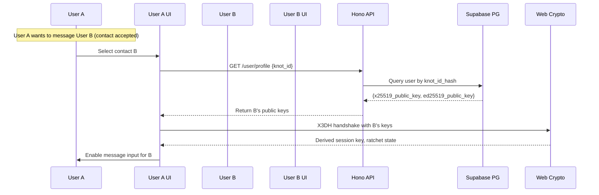

# API Specification

## Base URL

```https://knots-api.render.com/api/v1```

All endpoints require appropriate authentication (see Auth Flow). Base responses include:

- `200 OK` with data on success
- Error objects: `{ error: { code: string, message: string, details?: any } }`

## Endpoints

| Method | Path | Description | Auth | Request Body | Response |
|--------|------|-------------|------|--------------|----------|
| **POST** | `/auth/generate-keys` | Generate Ed25519 + X25519 keypair; derive Knot ID options | None (client-side) | `{}` | `{ knot_id_options: { base58: string, bip39_mnemonic: string }, ed25519_public_key: byte, x25519_public_key: byte }` |
| **POST** | `/auth/register` | Register Knot ID + public key to server | None (Knot ID is public) | `{ knot_id: string (base58 or mnemonic), public_key: object { x25519: byte, ed25519: byte } }` | `{ success: true, knot_id_hash: byte, registered_at: iso_timestamp }` |
| **POST** | `/contact/request` | Send contact request to another user | None (Knot ID public) | `{ target_knot_id: string }` | `{ request_id: string, status: 'pending', created_at: iso_timestamp }` |
| **POST** | `/contact/respond` | Accept/reject/block a contact request | Session (X3DH established) | `{ request_id: string, action: 'accept' | 'reject' | 'block' }` | `{ success: true, contact_status: string }` |
| **POST** | `/messages/send` | Send encrypted message to contact | Session (X3DH established) | `{ recipient_knot_id: string, ciphertext: string, nonce: string, ratchet_sequence: number, message_type: 'text' | 'image' }` | `{ success: true, message_id: string, ably_channel: string }` |
| **GET** | `/messages/status/{message_id}` | Check message delivery status | Session | `{ message_id: string }` | `{ status: 'pending' | 'delivered' | 'read', delivered_at?: iso_timestamp, read_at?: iso_timestamp }` |
| **POST** | `/keys/rotate` | Rotate keypair + generate new Knot ID | Session (passphrase optional) | `{ passphrase?: string }` | `{ new_knot_id: string, old_knot_id_invalidated: true, new_x25519_public_key: byte }` |
| **POST** | `/contacts/block` | Block a contact | Session | `{ target_knot_id: string }` | `{ success: true, blocked: true }` |
| **GET** | `/user/profile` | Get current user's profile (hashed data only) | Session | {} | `{ knot_id_hash: byte, created_at: iso_timestamp, is_online: boolean }` |

## Error Codes

| Code | Meaning | Response Format |
|------|---------|-----------------|
| `ERR_INVALID_KNOT_ID` | Knot ID format invalid or not registered | `{ error: { code: 'ERR_INVALID_KNOT_ID', message: 'Knot ID not found or malformed' } }` |
| `ERR_CONTACT_PENDING` | Contact request already exists or pending | `{ error: { code: 'ERR_CONTACT_PENDING', message: 'Contact request already pending' }` |
| `ERR_CONTACT_BLOCKED` | Target is blocked; cannot send messages | `{ error: { code: 'ERR_CONTACT_BLOCKED', message: 'Contact is blocked' }` |
| `ERR_SESSION_NOT_ESTABLISHED` | No X3DH session with recipient | `{ error: { code: 'ERR_SESSION_NOT_ESTABLISHED', message: 'No secure session with recipient' }` |
| `ERR_RATE_LIMITED` | Too many requests from this IP | `{ error: { code: 'ERR_RATE_LIMITED', message: 'Rate limit exceeded, try again later' }` |
| `ERR_MESSAGE_TOO_LARGE` | Ciphertext exceeds size limit (e.g., 100KB) | `{ error: { code: 'ERR_MESSAGE_TOO_LARGE', message: 'Message too large' }` |
| `ERR_INVALID_SESSION` | Session key expired or tampered | `{ error: { code: 'ERR_INVALID_SESSION', message: 'Session invalid, re-establish contact' }` |

## Authentication Flow

### X3DH Session Establishment

1. **Prerequisite**: User A and User B must have accepted contact requests (mutual contact)
2. **Process**:
   - User A retrieves User B's X25519 public key from Supabase
   - User A performs X3DH handshake:
     - Sender's long-term Ed25519 key pair + X25519 prekey
     - Receiver's X25519 identity key + Signed Prekey
     - One-time prekeys (rotating pool)
   - Derive shared secret via HKDF
   - Initialize Double Ratchet session with derived secret
3. **Session storage**: Transient in IndexedDB; re-established on each new contact acceptance



## Rate Limiting Strategy

| Endpoint | Limit | Window | Reason |
|----------|-------|--------|--------|
| **All POST endpoints** | 60 requests/minute | Per IP | Prevent spam, brute force |
| **Auth endpoints** (`/register`, `/keys/rotate`) | 10 requests/minute | Per IP | Prevent key injection spam |
| **Contact requests** | 5 requests/minute | Per user ID | Prevent contact flooding |
| **Message send** | 30 messages/minute | Per user ID | Prevent message flood |
| **GET endpoints** | 120 requests/minute | Per IP | General read access |
| **Ably channel publish** | 10 messages/second | Per channel | Ably free tier abuse prevention |

- **Implementation**: Hono middleware using `limiter`; stores counters in Redis (or in-memory for free tier without Redis)
- **Header**: `X-RateLimit-Remaining`, `X-RateLimit-Reset`
- **Abuse response**: `429 Too Many Requests` with retry-after header