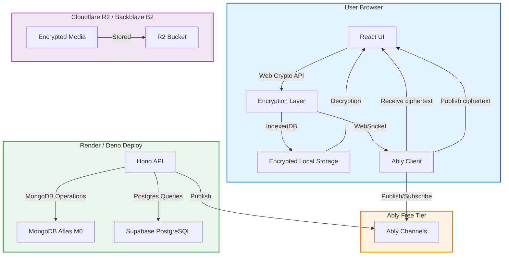
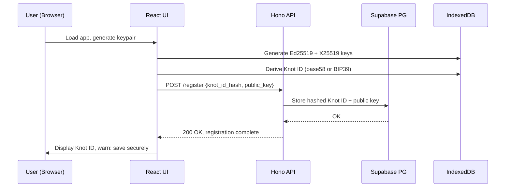
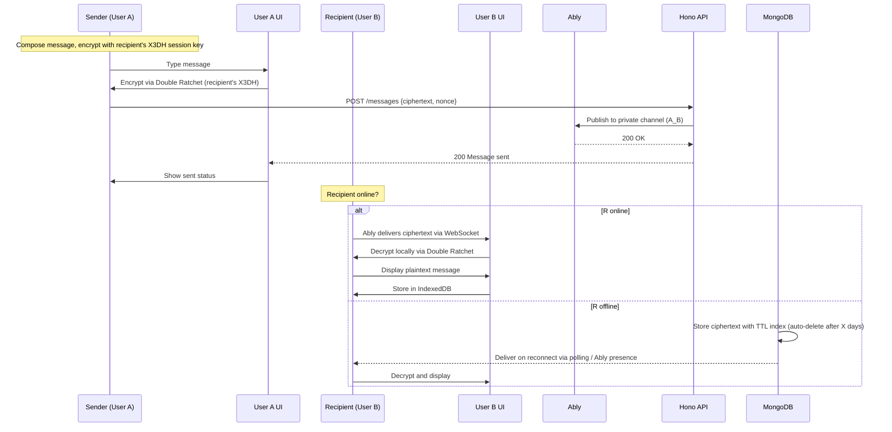

# System Architecture

## High-Level Diagram



### Component Breakdown

| Component | Technology | Responsibilities |
|-----------|------------|------------------|
| **React UI** | Next.js 14, TypeScript, Tailwind CSS, shadcn/ui | User interactions, routing, state management |
| **Web Crypto** | Web Crypto API, libsodium.js, @noble/curves | Key generation, X3DH, Double Ratchet, message encryption |
| **IndexedDB** | Dexie.js | Encrypted local storage of keys, messages, contact lists |
| **Ably Client** | Ably JS SDK | WebSocket pub/sub for real-time message distribution |
| **Hono API** | Hono (Bun runtime) | REST endpoints for registration, contact requests, key management |
| **Supabase PostgreSQL** | Postgres + Drizzle ORM | Hashed Knot IDs, contact request state, public keys, user metadata |
| **MongoDB Atlas M0** | MongoDB | Encrypted message blobs, offline queue with TTL auto-delete |
| **Cloudflare R2** | B2-compatible storage | Encrypted media files (images, voice notes) with v2-only access |
| **Sentry** | Free tier | Error tracking in production |
| **Biome** | Lint + format | TypeScript linting, prettier formatting |
| **Vitest** | Unit testing | Component tests, crypto test vectors, utility tests |
| **Playwright** | E2E testing | User flows: onboarding, messaging, contact flow, key rotation |

### Data Flow Diagrams

#### Registration Flow



#### Contact Request Flow

```mermaid
sequenceDiagram
    participant A as User A
    participant A_UI as User A UI
    participant B as User B
    participant B_UI as User B UI
    participant H as Hono API
    participant P as Supabase PG
    participant M as MongoDB

    Note over A: User A enters User B's Knot ID
    A->>A_UI: Input B's Knot ID
    A_UI->>H: POST /contact-request {target_knot_id}
    H->>P: Validate hashed Knot ID exists
    P-->>H: OK / Not found
    H-->>A_UI: 200 Request sent / 404 Not found
    A_UI->>A: Show "Contact request sent"

    Note over B: User B receives notification
    B->>B_UI: Push notification via Ably
    B_UI->>H: POST /contact-request/accept {request_id}
    H->>P: Update contact status to 'accepted'
    P-->>H: OK
    H-->>B_UI: 200 Accepted
    B_UI->>B: Show "You are now connected"

    Note: After acceptance, A can send encrypted messages to B
```

#### Message Send Flow



#### Key Rotation Flow

```mermaid
sequenceDiagram
    participant U as User
    participant U_UI as User UI
    participant H as Hono API
    participant P as Supabase PG
    participant K as IndexedDB

    Note over U: User initiates key rotation
    U->>U_UI: Click "Rotate keys"
    U_UI->>H: POST /keys/rotate {passphrase?}
    H->>P: Invalidate old keypair, store new Ed25519 + X25519
    P-->>H: OK
    H-->>U_UI: 200 New Knot ID generated
    U_UI->>K: Invalidate old keys, store new keys
    K-->>U_UI: Keys rotated
    U_UI->>U: Display new Knot ID; old one invalidated
    Note: All existing contacts must accept new Knot ID to resume messaging
```

### Sequence Diagrams (Critical Paths)

*See above data flow diagrams for complete sequence coverage.*