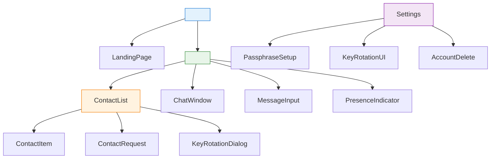

# Frontend Design

## Page/Route Structure

```
/ (landing)          - Privacy explanation, threat model summary, CTA to app
/login              - Not applicable; app is key-based, no login
/app                - Main chat interface (root route)
/contacts           - Contact list, request management, key rotation
/settings           - Passphrase setup, key rotation, account deletion
/pwa                - PWA manifest, service worker setup
```

**Route Groups** (App Router):

```
app/
  layout.tsx        - Global UI, Sentry error boundary, providers
  page.tsx          - Landing page (public)
  chat/
    page.tsx        - Main chat view (authenticated)
    contacts/
      page.tsx      - Contact list + requests
    settings/
      page.tsx      - Key rotation, passphrase
```

### Component Hierarchy



### State Management Strategy

| Store | Library | Contents | Persistence |
|-------|---------|----------|-------------|
| **Auth state** | Zustand | Current user: `{ knot_id, ed25519_key, x25519_keys, session_state }` | IndexedDB (via custom middleware) |
| **Contact state** | Zustand | List of contacts: `{ knot_id, status, last_seen, ratchet_state }` | IndexedDB |
| **Chat state** | TanStack Query | Current conversation: `{ messages, cursor, loading, error }` | Server-side (Ably + MongoDB); local cache in IndexedDB |
| **UI state** | React useState | Modals, open drawers, input focus | React state (not persisted) |
| **Cache** | TanStack Query | Stale-while-revalidate for contact lists, user profiles | IndexedDB fallback |

**Zustand Store Example** (simplified):

```typescript
// src/store/chat-store.ts
import create from 'zustand'
import { persist, createJSONStorage } from 'zustand/middleware'

type ChatState = {
  contacts: Contact[]
  setContacts: (contacts: Contact[]) => void
  addContact: (contact: Contact) => void
  removeContact: (id: string) => void
  currentKnotId: string | null
  setCurrentKnotId: (id: string | null) => void
  sessionRatchet: RatchetState | null
  setSessionRatchet: (state: RatchetState | null) => void
}

export const useChatStore = create(
  persist<ChatState>(
    (set) => ({
      contacts: [],
      setContacts: (contacts) => set({ contacts }),
      addContact: (contact) => set((state) => ({ contacts: [...state.contacts, contact] })),
      removeContact: (id) =>
        set((state) => ({ contacts: state.contacts.filter((c) => c.knot_id !== id) })),
      currentKnotId: null,
      setCurrentKnotId: (id) => set({ currentKnotId: id }),
      sessionRatchet: null,
      setSessionRatchet: (state) => set({ sessionRatchet: state }),
    }),
    {
      name: 'knots-storage',
      storage: createJSONStorage<ChatState>(() => localForage), // IndexedDB backend
    }
  )
)
```

### Local Storage Schema (IndexedDB)

**Dexie.js Schema** (simplified):

```javascript
// src/lib/indexeddb.js
import Dexie from 'dexie'

export class KnotsDB extends Dexie {
  users = table('users', {
    id: '++id',
    knot_id_hash: 'arraybuffer',       // Argon2id hash of Knot ID (32 bytes)
    x25519_public_key: 'arraybuffer',  // X25519 public key
    ed25519_public_key: 'arraybuffer', // Ed25519 public key
    ed25519_private_key: 'arraybuffer', // Only if passphrase-protected
    created_at: 'number',              // Timestamp
    last_seen_at: 'number'
  })

  contacts = table('contacts', {
    id: '++id',
    knot_id: 'string',                 // Knot ID (base58)
    status: 'string',                  'pending' | 'accepted' | 'blocked'
    ratchet_state: 'json',             // Double Ratchet state (root key, chain counter)
    created_at: 'number'
  })

  messages = table('messages', {
    id: '++id',
    sender_knot_id: 'string',
    recipient_knot_id: 'string',
    ciphertext: 'arraybuffer',         // Encrypted message
    nonce: 'arraybuffer',              // GCM nonce / XChaCha20 nonce
    message_type: 'string',            // 'text' | 'image' | 'voice_note'
    media_metadata: 'json',            // Optional: R2 key ref, dimensions, etc.
    created_at: 'number'
  })

  // TTL helper: mark message for auto-delete after X days
  markForDelete(messageId: string, ttlDays: number) {
    const message = this.messages.get(messageId)
    if (message) {
      message.expires_at = Date.now() + ttlDays * 24 * 60 * 60 * 1000
    }
  }
}

export const db = new KnotsDB('KnotsDB')

// Create on first use
db.version(1).stores({
  users: 'knot_id_hash',
  contacts: 'knot_id',
  messages: 'id'
})
```

### PWA Configuration

```json
// public/manifest.json
{
  "name": "Knots - Anonymous Chat",
  "short_name": "Knots",
  "description": "End-to-end encrypted anonymous chat",
  "start_url": "/",
  "display": "standalone",
  "background_color": "#ffffff",
  "theme_color": "#1976d2",
  "orientation": "any",
  "display_override": ["window-control-overlay"],
  "icons": [
    {"src": "favicon.ico", "sizes": "64x64", "type": "image/x-icon"},
    {"src": "logo192.png", "sizes": "192x192", "type": "image/png"},
    {"src": "logo512.png", "sizes": "512x512", "type": "image/png"}
  ]
}

// src/service-worker.ts (simplified)
const CACHE_NAME = 'knots-v1'
const REQUIRED_CACHE = [
  '/',
  '/_next/static/chunks/app.js',
  '/_next/static/chunks/webpack.js',
  '/_next/static/chunks/0.js',
  '/favicon.ico',
  '/manifest.json'
]

self.addEventListener('install', (event) => {
  event.waitUntil(
    caches.open(CACHE_NAME).then((cache) => {
      return cache.addAll(REQUIRED_CACHE)
    })
  )
  self.skipWaiting()
})

self.addEventListener('fetch', (event) => {
  if (event.request.method !== 'GET') return
  event.respondWith(
    caches.match(event.request).then((resp) => {
      return resp || fetch(event.request)
    })
  )
})

self.addEventListener('activate', (event) => {
  event.waitUntil(
    caches.keys().then((keys) => {
      return Promise.all(
        keys.filter((key) => key !== CACHE_NAME).map((key) => caches.delete(key))
      )
    })
  )
  self.clients.claim()
})