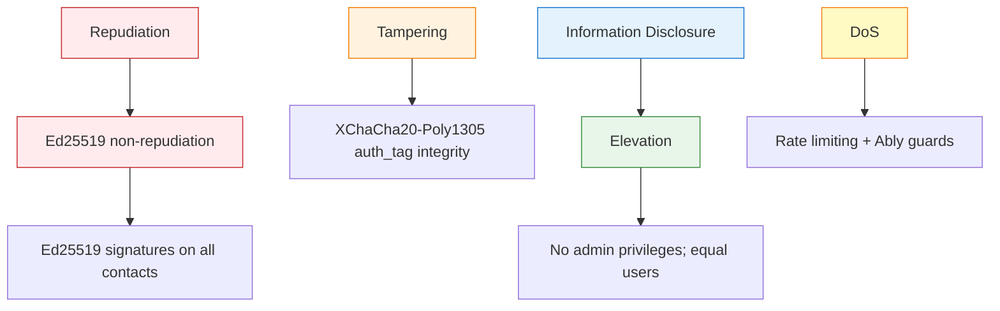

# Security Plan

## Threat Model (STRIDE)

| Threat Category | Specific Threat | Mitigation |
|-----------------|-----------------|------------|
| **Spoofing** | User impersonation via stolen Knot ID | Knot ID hashed via Argon2id; server never trusts raw Knot ID; Ed25519 signatures on all contact actions |
| **Tampering** | Message ciphertext modification | XChaCha20-Poly1305 provides integrity verification (auth_tag); any modification fails decryption |
| **Repudiation** | User denies sending a message | Ed25519 signature on contact requests and session establishment; each message signed within Double Ratchet |
| **Information Disclosure** | Plaintext leak via breach | Server stores only encrypted blobs + hashed Knot IDs; no PII; even database dump reveals nothing readable |
| **Denial of Service** | Flood of messages/requests | Rate limiting (60/min endpoint, 30/min per user); Ably flood protection; proof-of-work in v2 |
| **Elevation of Privilege** | Admin escalation | No admin accounts; all users equal; server-blind architecture limits damage |

### STRIDE Diagram



## Attack Surface Analysis

| Surface Area | Risk | Mitigation |
|--------------|------|------------|
| **Web Crypto API** | Browser implementation bugs | Use audited libraries (@noble/curves, libsodium.js); fallback paths; test across browsers |
| **IndexedDB** | XSS reading encrypted data | Content Security Policy (script-src 'self'); no dangerouslySetInnerHTML; input sanitization |
| **Ably WebSocket** | Channel enumeration, message replay | Private channels per contact pair (`knot_id_A_B`); Ably auth tokens per session |
| **Hono API** | Injection, mass assignment | Zod validation on all inputs; parameterized queries (Drizzle ORM); no dynamic SQL |
| **MongoDB** | Unauthorized access | Atlas IP whitelist; read-only for application user; TTL auto-delete limits breach impact |
| **Supabase PostgreSQL** | Row-level data leak | RLS (Row Level Security) policies; service role key only in backend; connection pooling |
| **R2 Storage** | Public bucket exposure | Bucket private by default; pre-signed URLs with expiration; encrypted upload |
| **Environment vars** | Secret leakage | Never commit .env; github secrets scanning; Biome detects leaked keys; rotate on suspicion |
| **Dependency chain** | Vulnerable transitive deps | Dependabot automated PRs; `npm audit` in CI; Biome lint catches suspicious patterns |

## Mitigations Per Threat

### Passive Network Attacker (TLS + E2EE)

- TLS 1.3 for all connections (Hono + Ably)
- E2EE ensures even if TLS terminated early, messages encrypted
- DNS over HTTPS (DoH) optional for users

### Malicious Server Operator (server-blind)

- Server has no private keys; all operations client-side
- Even with root access, only sees: hashed Knot IDs, public keys, contact request state, encrypted blobs
- No IP logging middleware; IP addresses stripped from incoming requests

### Database Breach

- Only ciphertext blobs + Argon2id hashes exposed
- No encryption keys stored on server (only in user browsers)
- Argon2id computationally expensive → rainbow table infeasible
- MongoDB TTL ensures automatic deletion; even if breach occurs, old messages auto-delete

### Subpoena

- No useful data to hand over: no PII, no plaintext, no traffic metadata (Ably handles routing)
- Knot IDs are hashed; Argon2id slow hash makes reversal infeasible
- Can plausibly deny user existence (no accounts, no emails)

### Malicious Contact

- Key rotation invalidates old sessions
- Blocking prevents further communication
- Disappearing messages limit damage window
- User can generate new Knot ID entirely

### Spam/Abuse

- Rate limiting per endpoint and per user
- CAPTCHA-free proof-of-work for message sending in v2 (if needed)
- Ably channel permissions require prior contact acceptance

## CSP, Headers, and Hardening

```http
# Recommended CSP for Knots App
Content-Security-Policy:
  default-src 'self';
  script-src 'self' 'unsafe-inline' https://cdn.jsdelivr.net;
  style-src 'self' 'unsafe-inline' https://cdn.jsdelivr.net;
  img-src 'self' data: https:;
  font-src 'self';
  connect-src self https://*.ably.io https://*.supabase.co;
  frame-src 'none';
  object-src 'none';
  base-uri 'self';
  form-action 'self';

# Recommended security headers
X-Content-Type-Options: nosniff
X-Frame-Options: DENY
X-XSS-Protection: 1; mode=block
Referrer-Policy: strict-origin-when-cross-origin
Permissions-Policy: camera=(), microphone=(), geolocation=()

# Hono middleware example (headers)
app.use(async (c, next) => {
  c.header('Content-Security-Policy', 
    "default-src 'self'; script-src 'self' 'unsafe-inline' https://cdn.jsdelivr.connect-src self https://*.ably.io;\"\n  )
  c.header('X-Content-Type-Options', 'nosniff')
  c.header('X-Frame-Options', 'DENY')
  c.header('X-XSS-Protection', '1; mode=block')
  c.header('Referrer-Policy', 'strict-origin-when-cross-origin')
  await next()
})
```

## Abuse Prevention Strategy

| Strategy | Implementation | Effort |
|----------|----------------|--------|
| **Rate limiting** | Hono middleware with in-memory counters (free tier) | Low |
| **Contact flood prevention** | Max 20 contact requests/day per user; cool-down periods | Low |
| **Message size limit** | Max 100KB ciphertext per message; larger files → media upload flow | Low |
| **Spam detection** | Heuristic: burst sending → temporary send throttling | Medium |
| **Abuse reporting** | In v2: report contact → server investigates contact request history | Medium (post-MVP) |
| **Proof-of-work** | v2: Hashcash-style required for new contact requests (mitigate automation) | High |